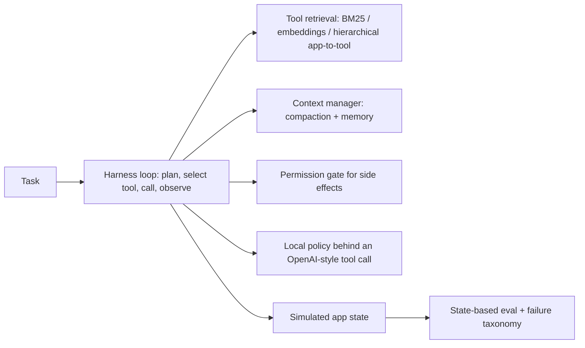

# Agent harness for large tool spaces

This project is a model-agnostic agent harness for multi-step tasks over a simulated ecosystem of 300+ app tools. It plans one call at a time, retrieves a small set of tool schemas, compacts older observations, and blocks side-effecting tools until the call is confirmed. Success is checked against the final app state. The same lexical policy is compared across retrieval strategies so the difference is the prompt, not a different model.

## Setup

Python 3.11 or 3.12 on Windows:

```
python -m venv .venv
.venv\Scripts\pip install -r requirements.txt
```

PyTorch is pinned to the CPU wheel (`--extra-index-url https://download.pytorch.org/whl/cpu` is the first line of `requirements.txt`).

## How to run

```
python run.py
python run.py --quick
python run.py --device cpu
```

`python run.py` generates the dataset under `data/`, evaluates the held-out test templates, and writes `results/`. `python run.py --quick` runs the same pipeline on 8 test tasks and skips the embedding model so it finishes in a few minutes. Optional flags: `--skip-oracle`, `--skip-coverage`, `--device cuda` (falls back to CPU when CUDA is missing).

## Architecture



The loop builds a prompt, keeps only the tool blocks that fit in a 2048-token window, asks the policy for one call, validates it with JSON Schema, and runs the permission gate before any state change. Retrieval configurations place the top 5 tools in the prompt. The baseline places every schema in the prompt and does not compact history.

## Design decisions

- **One policy for every configuration.** The reported agent is lexical grounding: among tools whose full schema block fits in the window, it selects the tool whose action phrase appears in the current clause and copies `key=value` arguments from that clause. The scripted oracle is an upper bound that may emit the labeled call only when that tool is visible. Both speak the same OpenAI-style tool-call object.
- **Context limit is fixed at 2048 tokens** and retrieval depth is fixed at 5. Those choices are constants in `harness/context.py`. They are not fit on the test split. The best row in the table is the pre-specified config with the highest test success, then the fewest prompt tokens, then the name.
- **Dev and test templates are disjoint.** Even template indexes are dev and odd indexes are test. `data/manifest.json` stores checksums. If the generator changes after the files exist, the run stops instead of silently rewriting the split.
- **Prompt tokens are counted with a whitespace-and-punctuation tokenizer** (`harness/tokens.py`) so every configuration is measured the same way, including on the quick path before any model download. Counts add across prompt pieces because whitespace is not a token.
- **Embeddings use frozen `sentence-transformers/all-MiniLM-L6-v2` vectors in a FAISS inner-product index.** The model is not trained on these tasks. `TransformersToolClient` can load a local instruct model behind the same interface. The ablation grid does not call it: scoring every test episode with a generative model on CPU would blow the time budget and the 3 GB memory cap.
- **Side effects require `confirm=True`.** The gate returns `confirmation_required` and leaves state unchanged. The policy then repeats the call with confirmation. Executed side effects without confirmation are counted in `unconfirmed_side_effects`.

## Dataset

The tool catalog and the 400 tasks are generated in process by `apps/catalog.py` and `evals/generate.py` (seed 0). There is no third-party task corpus and no user data. License: generated locally by this project. The run writes `data/tools.json`, `data/tasks.json`, and `data/manifest.json`, then checks row counts (at least 300 tools, 400 tasks, 40 dev templates, 40 test templates, disjoint template ids) and sha256 checksums. The MiniLM `config.json` is downloaded with `requests` and checked against a pinned sha256. MiniLM weights are fetched by sentence-transformers into `data/hf_home` on the full run. MiniLM is Apache 2.0.

Dev templates are a diagnostic (`results/dev_diagnostics.json`). Reported success, token, and Recall@5 numbers use test templates only.

## Results

The table is written by `python run.py` from `results/metrics.json`. Recompute success as the mean of `success` in `results/episodes.csv` grouped by `config`. Recompute prompt tokens as the mean of `prompt_tokens`. Recompute schema-valid rate as the sum of `schema_valid_calls` divided by the sum of `n_steps` across `episodes.csv` and `oracle_episodes.csv`. Recompute Recall@5 as the mean of `hit_at_5` in `results/retrieval.csv` for the retriever used by the best config. `gate_log.csv` sums to `unconfirmed_side_effects`.

<!-- RESULTS_START -->
| Config | Task success | Prompt tokens / task | Mean wrong-tool calls |
| --- | ---: | ---: | ---: |
| bm25_compact (best) | 100.0% | 1618.9 | 0.00 |
| hierarchical_compact | 100.0% | 1618.9 | 0.00 |
| embed_compact | 100.0% | 1631.4 | 0.00 |
| bm25 | 100.0% | 1666.0 | 0.00 |
| hierarchical | 100.0% | 1666.0 | 0.00 |
| embed | 100.0% | 1678.6 | 0.00 |
| all_tools_compact | 0.0% | 92509.0 | 1.80 |
| all_tools (baseline) | 0.0% | 92559.9 | 1.80 |

| Retriever | Recall@5 on test |
| --- | ---: |
| bm25 | 1.000 |
| embed | 1.000 |
| hierarchical | 1.000 |

| Criterion | Value | Threshold | Passed |
| --- | ---: | ---: | --- |
| Task success on held-out test templates (best configuration) minus all-tools baseline (points) | 100.0000 | >= 20.0 | True |
| Tool retrieval Recall@5 for the gold next tool | 1.0000 | >= 0.9 | True |
| Prompt token reduction vs all-tools baseline | 0.9825 | >= 0.6 | True |
| Side-effecting tool calls without required confirmation | 0.0000 | <= 0.0 | True |
| Schema-valid tool calls | 1.0000 | >= 0.98 | True |
| Test coverage | 0.9062 | >= 0.8 | True |
<!-- RESULTS_END -->

Plots written next to the metrics file: `success_by_config.png`, `tokens_by_config.png`, `recall_at_5.png`, `failure_types.png`.

## Limitations

Tool descriptions contain the same action phrase the task generator puts in the clause, so Recall@5 is an upper view of retrieval under a controlled lexicon. Held-out variation is the template id, the slot values, the wrapper (`Please` versus `User request:`), and which steps are composed. Open-vocabulary paraphrases would be harder.

The lexical policy reads that phrase. It shows how much of the task is solved once the right schema is inside the window. It is a deterministic stand-in for a careful reader with five tools, and the oracle row is the labeled upper bound under the same window. A generative instruct model is wired up and left out of the grid for CPU time and memory.

The all-tools baseline scores 0% on seed 0 because the window keeps only the prefix of the shuffled catalog that fits, and that prefix did not contain the first gold tool of any held-out task. The scripted oracle, which may emit the labeled call only when that tool is visible, scores 0% on the same baseline and 100% once retrieval places the gold tool in the window. Retrieval success of 100% follows from the shared action phrase. The window size and retrieval depth were fixed before the test split was scored.

History is placed after the tool list, so a tail truncation drops old observations before it drops the highest-ranked tools. Compaction therefore saves tokens on longer episodes and often leaves the visible tool set unchanged. Failure labels come from the episode trace and the state check: wrong tool, bad arguments, premature stop, loop, schema invalid, and budget exceeded.

## Tests

```
python -m pytest --cov=harness --cov=apps --cov=evals --cov-report=term-missing
```
