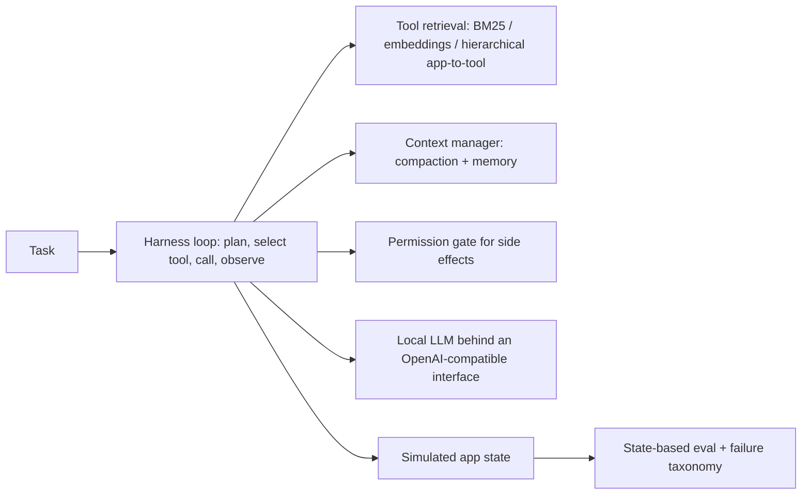

# Agent Harness for Large Tool Spaces - Tool Retrieval, Context Compaction and Multi-Step Evals

`agent-tool-harness` · new project · estimated build effort: 5 h

## Problem

Assistants must pick the right action from hundreds of app tools under tight latency and context budgets. This project builds a model-agnostic agent harness (planner loop, typed tool schemas, tool retrieval, context compaction, step budget, permission gates for side-effecting tools) and an eval suite of multi-step tasks over a synthetic app ecosystem of 300+ tools (calendar, notes, messages, files, settings, shopping). It compares tool-representation and retrieval strategies on task success, wrong-tool rate, tokens and latency, and analyzes failure modes, using a small open model run locally plus a deterministic scripted oracle for upper bounds.

## Target jobs and skills

- **Apple — Applied AI Engineer, Agent Harness** (`2d9909653024`): covers 79% of the JD's weighted top skills (AI Agents, LLMs, LLM APIs, Optimization, LLM Evaluation, Prompt Engineering, Python)
- **Apple — Senior Applied AI Engineer, Agent Tools & Capabilities** (`64d3be014af3`): covers 71% of the JD's weighted top skills (Python, AI Agents, LLMs, LLM Evaluation, Prompt Engineering, Optimization)
- **Robinhood — Software Engineer, AI Security** (`e226762744b9`): covers 45% of the JD's weighted top skills (Python, AI Agents, LLMs)

Skills/tools this project demonstrates: Python, AI Agents, LLMs, LLM APIs, LLM Evaluation, Prompt Engineering, Ranking & Retrieval, Embeddings, FAISS, Hugging Face, Optimization, Model Evaluation

## Data

- **Dataset:** Synthetic tool ecosystem and task suite (generated by script) — n/a (generators in the repo)
- **License/terms:** generated locally
- **Size used:** 300+ tool schemas across 12 apps; 400 multi-step tasks (1-6 tool calls) with programmatic success checks; disjoint dev/test templates
- **Plan:** Tasks generated from templates with seeded slot values; dev templates used for prompt and representation tuning, test templates held out. Success is checked against final app state, not model text.

## Architecture

## Tech stack

Python 3.11, Hugging Face transformers (small instruct model, CPU) behind an OpenAI-compatible interface, sentence-transformers + FAISS for tool retrieval; rank_bm25, pydantic tool schemas, JSON-schema validation, pytest

## Deliverables

- harness/ (loop, tool registry, schema validation, retrieval, context compaction, permission gate, step/latency budget)
- apps/ (simulated app ecosystem with state and 300+ tools)
- evals/ (task generator, state checkers, failure taxonomy, ablation runner)
- Ablation tables - all-tools-in-prompt vs. BM25 vs. embedding vs. hierarchical retrieval; with and without compaction

## Success criteria (all must hold on a from-scratch `python run.py`)

| Metric | Threshold | How it is measured |
|---|---|---|
| Task success on held-out test templates (best configuration) | at least 20 points higher than the all-tools-in-prompt baseline | same model, same tasks |
| Tool retrieval Recall@5 for the gold next tool | >= 0.90 | test templates |
| Prompt tokens per task (best configuration) | at least 60% fewer than the all-tools-in-prompt baseline | tokenizer counts |
| Side-effecting tool calls without required confirmation | 0 | permission-gate test matrix and eval logs |
| Schema-valid tool calls | >= 98% | JSON-schema validation of every call |
| Test coverage | >= 80% | pytest --cov |

## Evaluation artifacts (required; the evaluator recomputes metrics from these)

- results/metrics.json with keys success_by_config, recall_at_5, tokens_per_task_by_config, unconfirmed_side_effects, schema_valid_rate, n_test_tasks, seeds
- results/episodes.csv (task_id, split, config, success, n_steps, wrong_tool, schema_valid_calls, prompt_tokens, latency_ms, failure_type)

## Baseline

Same model with all tool schemas placed in the prompt, no retrieval and no context compaction.

## Constraints

- Runs on Windows with `python run.py` from a fresh virtualenv; no make, shell scripts, paid APIs, or accounts.
- CPU-only by default (an optional `--device cuda` flag is fine); peak RAM <= 3 GB; total downloads <= 1.5 GB.
- PyTorch (if used) pinned to the CPU wheel via `--extra-index-url https://download.pytorch.org/whl/cpu`.
- Fixed random seeds; every reported number is written by code to results/metrics.json (never typed by hand).
- Test split is created once, saved, and never used for training, tuning, or threshold selection.
- Data download is scripted (Python requests), cached under data/, and verified by checksum or row count.
- Apps and tasks are simulated; no real user data; local model only, no paid APIs.

## Draft resume bullets (placeholders are filled only with reproduced metrics)

- Built an agent harness over a simulated 300+-tool app ecosystem with tool retrieval, context compaction and permission gates, raising held-out multi-step task success from [BASE_SUCCESS]% to [SUCCESS]%
- Reached [RECALL5] Recall@5 for next-tool retrieval while cutting prompt tokens per task by [TOKEN_CUT]%
- Wrote state-based evals and a failure taxonomy (wrong tool, bad arguments, premature stop, loops) to drive harness changes

## Scope change (2026-10-12, overrides earlier sections; reviewer)

Iteration 1 was rejected in review: the reported agent was a deterministic lexical matcher, not a language model, the test
instructions contain the tool's action phrase verbatim (so BM25/embedding retrieval is trivially perfect), and the
all-tools baseline scores 0% only because its prompt cannot fit a 2,048-token window. Those numbers cannot go on a resume.
Required changes:

1. **A real generative model is the reported agent.** Use `Qwen/Qwen2.5-1.5B-Instruct` (Apache-2.0) locally, preferably as a
   GGUF Q4_K_M file via `llama-cpp-python` (or transformers + CUDA torch). This machine has an NVIDIA RTX 3060 Laptop GPU
   (6 GB VRAM, driver 616.92): use it when available, fall back to CPU. Greedy decoding, fixed seed. The model must emit
   the tool call itself (JSON tool-call object); the harness may validate and retry once on schema errors (count retries).
   Keep the lexical policy and the oracle only as extra rows labeled as such.
2. **Paraphrased test instructions.** Test-template instructions must describe the goal in natural language that does
   NOT contain the tool's action phrase or tool name verbatim (e.g. "push my 3pm with Dana to Friday" for
   `calendar.reschedule_event`). Dev templates may be simpler. Add column `instruction_mentions_tool` (0/1) to
   `results/retrieval.csv`; it must be 0 for at least 80% of test rows.
3. **A fair baseline.** The baseline is the same LLM with all tool schemas in the prompt, truncated to the model's real
   context budget you configure (use 8,192 tokens, counted with the model's own tokenizer for every config), in catalog
   order. Also report a second baseline: same LLM with 5 random tools. Count tokens with the model tokenizer.
4. **Grid size for time:** LLM rows on the 200 held-out test tasks for at least these configs: `all_tools`,
   `random5`, best retriever without compaction, best retriever with compaction. Others may use 100 tasks.
5. **Artifacts** (exact columns): `results/episodes.csv` adds `agent` (e.g. `qwen2.5-1.5b`, `lexical`, `oracle`),
   `n_calls`, `schema_retries`; `results/retrieval.csv` as before plus `instruction_mentions_tool`;
   `results/gate_log.csv` unchanged. `metrics.json` adds `llm_model`, `llm_device`, and `success_by_config` /
   `tokens_per_task_by_config` for the LLM agent.
6. **Resources:** host RAM peak under 4 GB; VRAM under 5.5 GB; total new downloads under 3 GB. Use a CUDA wheel only if it
   installs cleanly; otherwise CPU with a reduced but documented grid. Disk is tight: do not keep duplicate model files.
7. Report honestly: if retrieval or compaction does not beat the baseline by 20 points with the LLM, say so; do not tune
   on test templates.

## Environment rule (2026-10-15, overrides earlier sections; reviewer)
Never start, stop or restart Docker Desktop, WSL (wsl --shutdown, wsl --terminate) or any Windows service from project code or from your own commands. If `docker info` fails, exit with a clear error message instead. The reviewer keeps Docker running.

