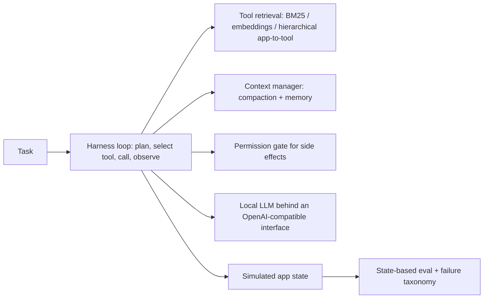

# Agent Harness for Large Tool Spaces - Tool Retrieval, Context Compaction and Multi-Step Evals

`agent-tool-harness` · new project · estimated build effort: 5 h

## Problem

Assistants must pick the right action from hundreds of app tools under tight latency and context budgets. This project builds a model-agnostic agent harness (planner loop, typed tool schemas, tool retrieval, context compaction, step budget, permission gates for side-effecting tools) and an eval suite of multi-step tasks over a synthetic app ecosystem of 300+ tools (calendar, notes, messages, files, settings, shopping). It compares tool-representation and retrieval strategies on task success, wrong-tool rate, tokens and latency, and analyzes failure modes, using a small open model run locally plus a deterministic scripted oracle for upper bounds.

## Target jobs and skills

- **Apple — Applied AI Engineer, Agent Harness** (`2d9909653024`): covers 79% of the JD's weighted top skills (AI Agents, LLMs, LLM APIs, Optimization, LLM Evaluation, Prompt Engineering, Python)
- **Apple — Senior Applied AI Engineer, Agent Tools & Capabilities** (`64d3be014af3`): covers 71% of the JD's weighted top skills (Python, AI Agents, LLMs, LLM Evaluation, Prompt Engineering, Optimization)
- **Robinhood — Software Engineer, AI Security** (`e226762744b9`): covers 45% of the JD's weighted top skills (Python, AI Agents, LLMs)

Skills/tools this project demonstrates: Python, AI Agents, LLMs, LLM APIs, LLM Evaluation, Prompt Engineering, Ranking & Retrieval, Embeddings, FAISS, Hugging Face, Optimization, Model Evaluation

## Data

- **Dataset:** Synthetic tool ecosystem and task suite (generated by script) — n/a (generators in the repo)
- **License/terms:** generated locally
- **Size used:** 300+ tool schemas across 12 apps; 400 multi-step tasks (1-6 tool calls) with programmatic success checks; disjoint dev/test templates
- **Plan:** Tasks generated from templates with seeded slot values; dev templates used for prompt and representation tuning, test templates held out. Success is checked against final app state, not model text.

## Architecture

## Tech stack

Python 3.11, Hugging Face transformers (small instruct model, CPU) behind an OpenAI-compatible interface, sentence-transformers + FAISS for tool retrieval; rank_bm25, pydantic tool schemas, JSON-schema validation, pytest

## Deliverables

- harness/ (loop, tool registry, schema validation, retrieval, context compaction, permission gate, step/latency budget)
- apps/ (simulated app ecosystem with state and 300+ tools)
- evals/ (task generator, state checkers, failure taxonomy, ablation runner)
- Ablation tables - all-tools-in-prompt vs. BM25 vs. embedding vs. hierarchical retrieval; with and without compaction

## Success criteria (all must hold on a from-scratch `python run.py`)

| Metric | Threshold | How it is measured |
|---|---|---|
| Task success on held-out test templates (best configuration) | at least 20 points higher than the all-tools-in-prompt baseline | same model, same tasks |
| Tool retrieval Recall@5 for the gold next tool | >= 0.90 | test templates |
| Prompt tokens per task (best configuration) | at least 60% fewer than the all-tools-in-prompt baseline | tokenizer counts |
| Side-effecting tool calls without required confirmation | 0 | permission-gate test matrix and eval logs |
| Schema-valid tool calls | >= 98% | JSON-schema validation of every call |
| Test coverage | >= 80% | pytest --cov |

## Evaluation artifacts (required; the evaluator recomputes metrics from these)

- results/metrics.json with keys success_by_config, recall_at_5, tokens_per_task_by_config, unconfirmed_side_effects, schema_valid_rate, n_test_tasks, seeds
- results/episodes.csv (task_id, split, config, success, n_steps, wrong_tool, schema_valid_calls, prompt_tokens, latency_ms, failure_type)

## Baseline

Same model with all tool schemas placed in the prompt, no retrieval and no context compaction.

## Constraints

- Runs on Windows with `python run.py` from a fresh virtualenv; no make, shell scripts, paid APIs, or accounts.
- CPU-only by default (an optional `--device cuda` flag is fine); peak RAM <= 3 GB; total downloads <= 1.5 GB.
- PyTorch (if used) pinned to the CPU wheel via `--extra-index-url https://download.pytorch.org/whl/cpu`.
- Fixed random seeds; every reported number is written by code to results/metrics.json (never typed by hand).
- Test split is created once, saved, and never used for training, tuning, or threshold selection.
- Data download is scripted (Python requests), cached under data/, and verified by checksum or row count.
- Apps and tasks are simulated; no real user data; local model only, no paid APIs.

## Draft resume bullets (placeholders are filled only with reproduced metrics)

- Built an agent harness over a simulated 300+-tool app ecosystem with tool retrieval, context compaction and permission gates, raising held-out multi-step task success from [BASE_SUCCESS]% to [SUCCESS]%
- Reached [RECALL5] Recall@5 for next-tool retrieval while cutting prompt tokens per task by [TOKEN_CUT]%
- Wrote state-based evals and a failure taxonomy (wrong tool, bad arguments, premature stop, loops) to drive harness changes
